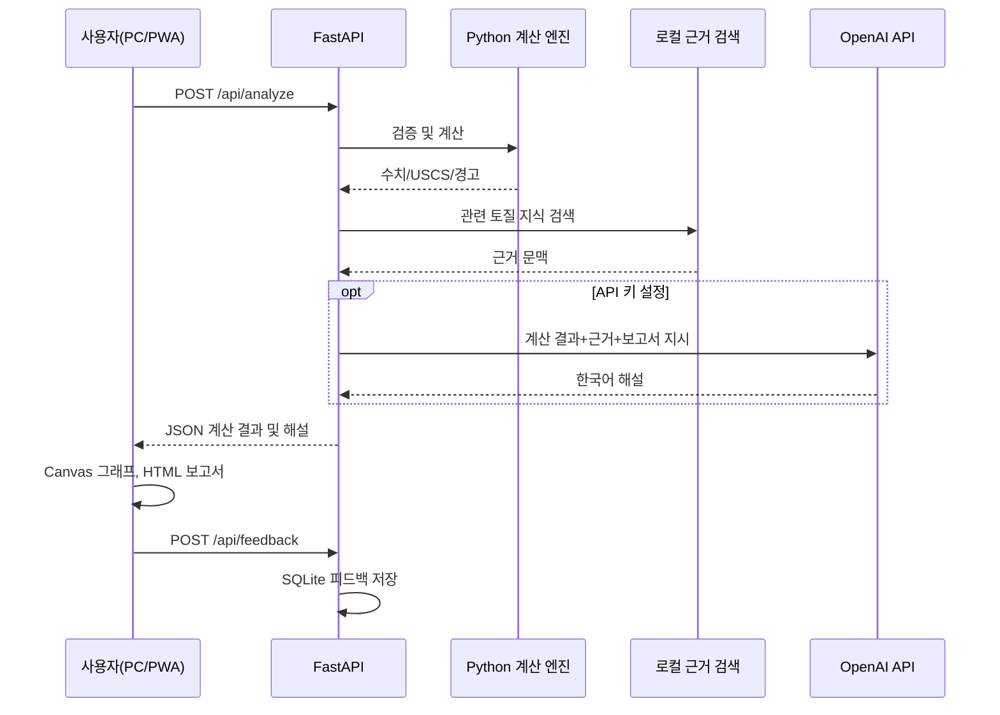
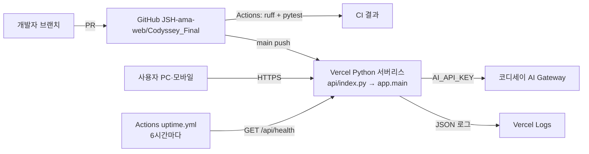

# 시스템 아키텍처 및 데이터 흐름

## 기술 의사결정
- FastAPI: Python 공학 계산 모듈을 HTTP API로 쉽게 노출
- HTML/CSS/JS: 빌드 도구 없는 간단한 배포와 가벼운 모바일 화면
- PWA: 별도 Android/iOS 앱스토어 심사 없이 홈 화면 설치 가능
- Canvas: 서버 렌더링 의존 없이 즉시 그래프 작성
- SQLite: 로컬 실습용 저장, 공개 서비스 영구 저장에는 DB 이전 필요
- 코디세이 AI Gateway(copa.codyssey.kr): 수치 계산 제외, 해설 작성에만 사용. Anthropic 형식 우선, 404/405 시 OpenAI 호환 형식으로 자동 전환, 실패 시 로컬 해설
- Vercel Python 서버리스: GitHub `main` push 시 자동 배포, PR마다 Preview 배포
- ruff + pytest + GitHub Actions: 코드 스타일·정적 분석·테스트를 PR마다 자동 실행

## 신뢰 경계
프론트엔드 입력은 신뢰하지 않는다. 모든 계산은 서버에서 검증한다. AI_API_KEY는 Vercel 환경 변수로만 두고 `/api/health`에도 값은 노출하지 않는다. LLM이 반환한 텍스트는 textContent로 렌더링하여 HTML 실행을 차단한다. 공개 API에는 속도 제한·관리자 인증이 없으므로 운영 배포 전 보강한다.

## 배포 및 운영 구성 (v14.1)

| 항목 | 값 |
|---|---|
| 원격 저장소 | https://github.com/JSH-ama-web/Codyssey_Final |
| 배포 URL | https://no-one-can-know-the-soil.vercel.app |
| 진입점 | `api/index.py` (FastAPI ASGI), `vercel.json`이 모든 경로를 전달 |
| 환경 변수 | `AI_API_KEY`(필수), `AI_MODEL`, `AI_BASE_URL`, `AI_API_FORMAT` |
| 운영 문서 | [13 실행 검증](13_실행_검증_및_테스트_로그.md), [14 운영 모니터링](14_운영_모니터링_및_오류_로그.md), [15 개발 프로세스](15_개발_프로세스_및_기여.md) |
| 사용자 테스트 | [04 사용자 테스트](04_사용자_테스트_및_피드백.md) |
