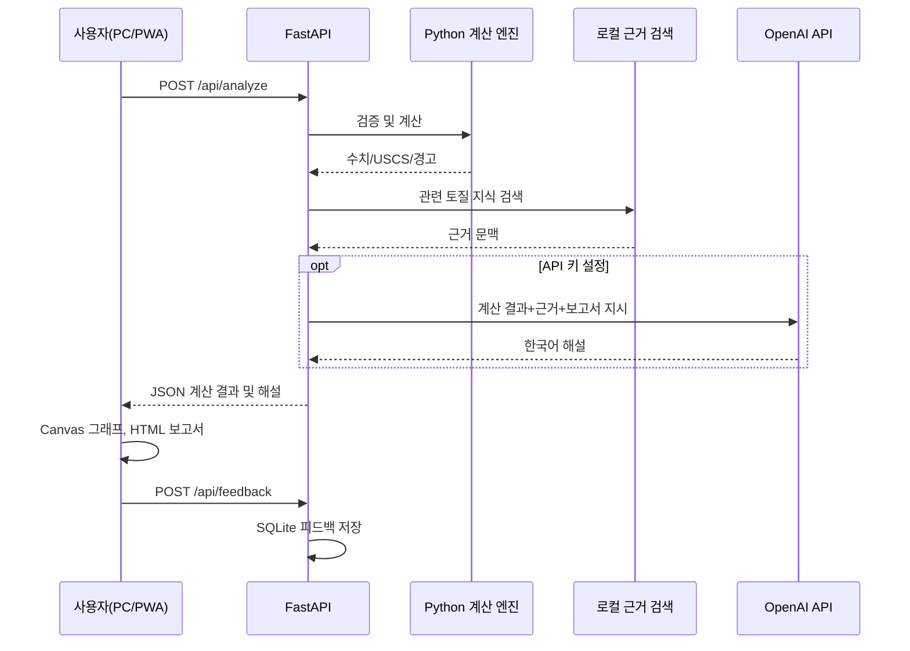

# 시스템 아키텍처 및 데이터 흐름

## 기술 의사결정
- FastAPI: Python 공학 계산 모듈을 HTTP API로 쉽게 노출
- HTML/CSS/JS: 빌드 도구 없는 간단한 배포와 가벼운 모바일 화면
- PWA: 별도 Android/iOS 앱스토어 심사 없이 홈 화면 설치 가능
- Canvas: 서버 렌더링 의존 없이 즉시 그래프 작성
- SQLite: 로컬 실습용 저장, 공개 서비스 영구 저장에는 DB 이전 필요
- OpenAI: 수치 계산 제외, 설명과 초안 작성에만 사용

## 신뢰 경계
프론트엔드 입력은 신뢰하지 않는다. 모든 계산은 서버에서 검증한다. OpenAI 키는 서버에만 둔다. LLM이 반환한 텍스트는 textContent로 렌더링하여 HTML 실행을 차단한다. 공개 API에는 속도 제한·관리자 인증이 없으므로 운영 배포 전 보강한다.
